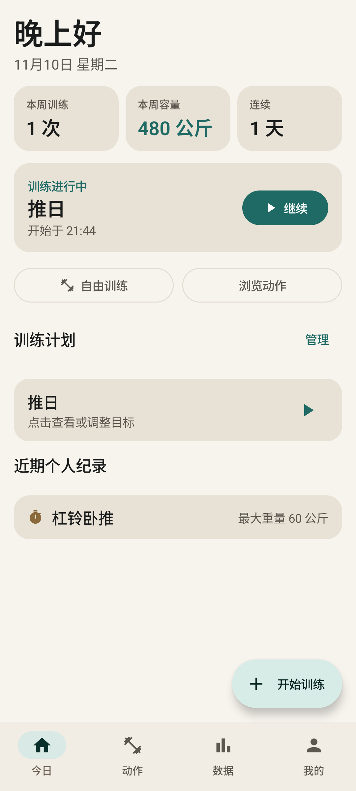
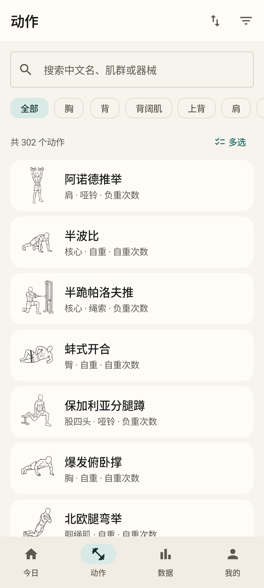
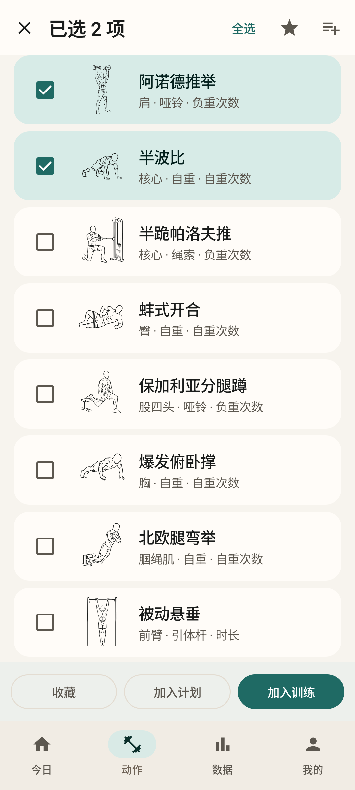
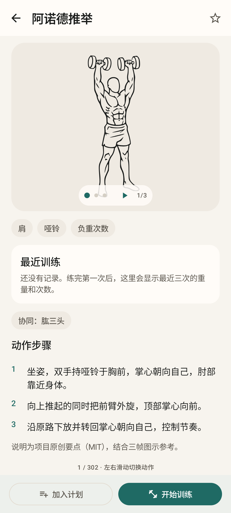
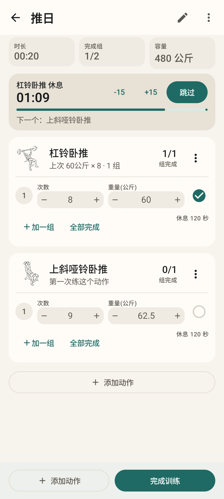
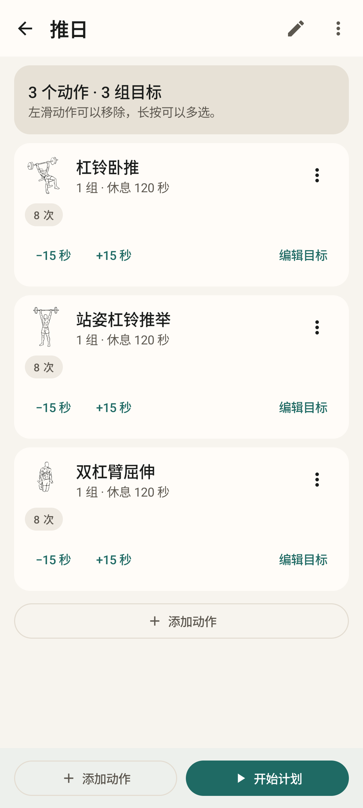
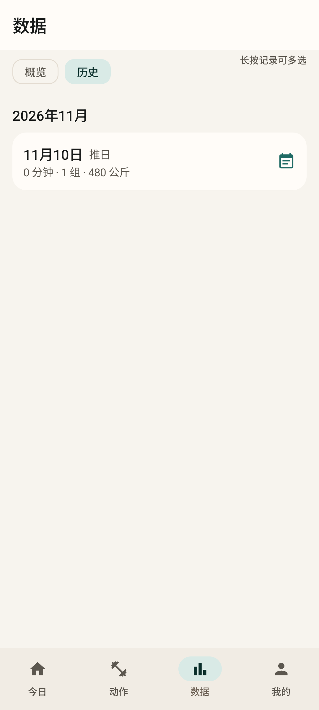
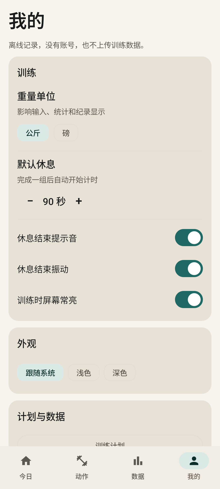
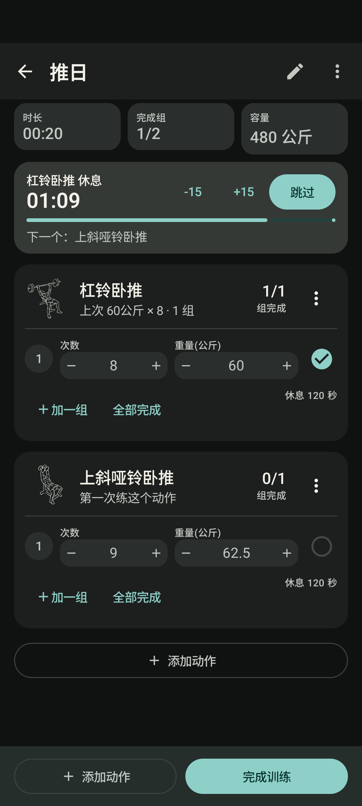

# 练迹 · Lianji

**离线、开源、说中文的健身训练记录。**
302 个动作、每个三帧动作图、计划 / 组 / 休息 / 个人纪录，全部留在本机。

[](https://github.com/ylfeng250/lianji/actions/workflows/ci.yml)
[](https://github.com/ylfeng250/lianji/releases)
[](LICENSE)
[](LICENSE-ASSETS)
[](#下载)
[](#隐私与数据)

[功能](#功能) · [截图](#截图) · [下载](#下载) · [构建](#构建) · [素材与许可](#素材与许可) · [English](#english)

## 为什么做这个

想找一个能安静记录训练的中文 App：动作演示离线、动作名字看得懂、训练时单手能完成记录、数据不被账号和订阅绑架。
试过一些记录应用后，练迹把需要的部分留下，把不需要的部分删掉，并且把代码公开出来，方便自己改、也方便别人参考。

- **完全离线**：安装包不申请 `INTERNET` / `ACCESS_NETWORK_STATE` 权限，没有账号、广告、分析 SDK。
- **中文动作库**：302 个动作都有中文说明，其中 85 个的分步文字译自 free-exercise-db，另外 217 个是项目原创要点。
- **动作图来自开源项目**：[Workout Guide](https://github.com/bryllim/workout-guide) 的三帧 SVG，转成矢量图并按主题色着色。
- **适合单手**：长按多选、左右滑动、删除撤销、步进器记组、固定在顶部的休息计时。

交互取舍和每个页面的设计决策记录在 [docs/INTERACTION.md](docs/INTERACTION.md)。

## 功能

### 动作库

- 302 个动作，按拼音、肌群、器械或收藏排序；筛器械、训练类型，或只看详细步骤/收藏。
- 列表右滑收藏、左滑加入当前训练；长按多选后可以批量收藏、加入计划、加入训练。
- 详情页左右翻页切换动作，三帧图自动播放/暂停、点圆点手动切帧。
- 详情页显示最近三次训练；底部固定「开始训练 / 加入计划」。

### 训练

- 每组用步进器改重量和次数，点数字可精确输入；新组自动沿用上一组。
- 组类型（普通/热身/递减/力竭）、RPE、备注收进编辑面板，不打断记录。
- 完成一组自动开始休息：计时固定在顶部，可 ±15 秒或跳过，并提示下一个动作。
- 左滑删组、菜单里上移/下移/替换/全部完成/移除动作；删除都能撤销。
- 动作卡上显示「上次 60公斤 × 8 · 3 组」，避免凭记忆加重。

### 计划

- 新建、复制、删除计划；内置推/拉/腿三个基础计划。
- 左滑移除动作、长按批量移除；「编辑目标」面板改每组次数、重量和休息。
- 计划详情一键开始；训练中也可以从计划追加动作。

### 数据

- 每周训练次数、容量、肌群组数、连续训练天数和动作趋势。
- 历史按月份分组；点进单次训练详情，左滑删除、长按批量删除，支持「再来一次」。
- 估算 1RM 使用 Epley 公式，只在 1–10 次时显示，并明确标为估算。
- 导出/恢复 `.lianji` 备份（系统文件选择器，不上传）。

### 界面

- Material 3，暖米色 + 墨绿，浅色/深色/跟随系统。
- 中文界面，字号和行高针对阅读调过；动作图跟随主题色。

## 截图

| 今日 | 动作库 | 长按多选 |
|---|---|---|
|  |  |  |

| 动作详情 | 训练中 | 计划编辑 |
|---|---|---|
|  |  |  |

| 历史 | 我的 | 深色主题 |
|---|---|---|
|  |  |  |

## 下载

从 [GitHub Releases](https://github.com/ylfeng250/lianji/releases/latest) 下载最新 APK，或在本地构建：

```bash
adb install -r lianji-1.1.0.apk
```

- 支持 Android 7.0（API 23）及以上，`targetSdk 36`。
- APK 约 21 MB，包含全部 906 张矢量动作图，安装后不需要联网。
- 官方 release 由维护者签名，并附带同名的 `.sha256` 校验文件；不同签名的包不能覆盖安装。
- 如果你自己构建且没有配置发布密钥，会退回 debug 签名，适合自用，不适合分发给别人升级。

## 技术栈与结构

| 层 | 选择 |
|---|---|
| 语言 / UI | Kotlin 2.2、Jetpack Compose、Material 3 |
| 数据 | Room 3（bundled SQLite）、DataStore Preferences |
| 导航 | Navigation Compose，单 Activity |
| 构建 | AGP 8.13、JDK 21、compileSdk 36、minSdk 23、R8 + 资源压缩 |
| 架构 | MVVM + Repository，手动依赖装配（`AppContainer`），不引入 DI 框架 |

```
app/
  src/main/java/com/superman/lianji/
    core/data/        仓库、设置、备份、目录导入
    core/database/    Room 实体与 DAO
    core/domain/      训练规则、统计、备份格式
    core/ui/          主题、通用组件、滑动/多选、Snackbar 撤销
    feature/          今日、动作库/详情、训练、计划、数据、我的
  src/main/assets/    动作目录 JSON、许可文本
  src/main/res/       906 张矢量动作图、图标
catalog-tools/        动作目录生成与校验（Python + Kotlin 测试）
docs/                 交互设计、发版说明、截图
```

动作图只在运行时按名字查找，因此由 `app/src/main/res/raw/keep.xml` 保留，并由
`assembleRelease` 的 `assertExerciseArtRetained` 检查是否仍在包里。

## 构建

需要 JDK 21 和 Android SDK 36。`local.properties` 写 `sdk.dir=...`，或者设置 `ANDROID_HOME`。

```bash
git clone https://github.com/ylfeng250/lianji.git
cd lianji
./gradlew :catalog-tools:test :app:testDebugUnitTest :app:assembleDebug
```

发布包（本地默认 debug 签名，正式发布请配置密钥）：

```bash
./gradlew :app:assembleRelease
# app/build/outputs/apk/release/app-release.apk
```

发布签名通过环境变量或 `keystore.properties` 提供，详见 [docs/RELEASING.md](docs/RELEASING.md)。

动作目录已经提交在 `app/src/main/assets/`，普通构建不需要重新生成。只有修改动作图/名称/步骤时才需要：

```bash
git clone https://github.com/bryllim/workout-guide.git third_party/workout-guide-src
python3 catalog-tools/generate_catalog.py
./gradlew :catalog-tools:test :app:testDebugUnitTest
```

## 测试

```bash
# JVM 单元测试 + 动作目录校验 + 资源保留检查
./gradlew :catalog-tools:test :app:testDebugUnitTest

# 设备测试（需要手机或模拟器）
./gradlew :app:connectedDebugAndroidTest
```

设备测试覆盖长按多选、批量收藏、计划/训练/历史的滑动删除与撤销、详情翻页、加组沿用上一组，
以及一个专门防回归的用例：改计划目标不能丢动作和组。`ScreenshotTest` 会把主要界面截图到
`Android/data/com.superman.lianji/files/screens`，用于人工检查。

CI 在每次 push/PR 时跑单元测试、debug 构建和 release 构建；release 工作流见
[.github/workflows/release.yml](.github/workflows/release.yml)。

## 隐私与数据

- 安装包**不包含** `android.permission.INTERNET` 或 `ACCESS_NETWORK_STATE`；构建时会检查合并后的清单。
- 没有账号、广告、分析 SDK、崩溃上报；应用不会发起任何网络请求。
- 训练数据保存在 Room 数据库和 DataStore，`android:allowBackup="false"`，不参与系统云备份。
- 备份只在你主动导出时写入你选择的文件，恢复也只从你选择的文件读取。
- 唯一的显式权限是 `VIBRATE`，用于休息结束振动（可在设置里关掉）。

## 素材与许可

**代码和素材的许可证是分开的**：

| 内容 | 来源 | 许可 |
|---|---|---|
| 应用代码、构建脚本、测试 | 本项目 | [MIT](LICENSE) |
| 动作图（`res/drawable/ex_*.xml`） | [Workout Guide](https://github.com/bryllim/workout-guide) by Bryl Lim；部分第一帧改编自 [Everkinetic](https://github.com/everkinetic/data) | [CC BY-SA 4.0](LICENSE-ASSETS) |
| 分步文字 | 85 个动作译自 [free-exercise-db](https://github.com/yuhonas/free-exercise-db)（Translated into Chinese）；217 个为项目原创要点 | Unlicense + MIT |
| 截图（含动作图） | 本项目 | CC BY-SA 4.0 |
| 交互设计参考 | [GymMane](https://github.com/InlitX/GymMane)、[LibreFit](https://github.com/LibreFitOrg/LibreFit) | 只参考公开界面与产品思路，未使用其 GPL 代码 |

- 本项目的改动：SVG → Android VectorDrawable、拆分过长路径、按主题色着色、三帧选取、中文元数据。
- 修改后的动作图继续以 **CC BY-SA 4.0** 提供；再分发或修改时请保留署名并注明改动。
- 完整署名、上游链接和改动说明见 [NOTICE.md](NOTICE.md)；应用内「关于、隐私与许可」也展示同一份文本。
- 不使用 free-exercise-db 的图片；没有可靠文字匹配的动作使用项目原创要点，不冒充上游来源。

如果你发现署名或来源有误，请开 issue，会尽快修正。

## 贡献

欢迎 issue、翻译、动作/步骤纠错和代码改进，先看 [CONTRIBUTING.md](CONTRIBUTING.md)。
不接受：联网同步/账号/分析 SDK、来源不明的图片、医疗或康复承诺。

## 版本记录

见 [CHANGELOG.md](CHANGELOG.md)。当前版本 1.1.0。

## 免责声明

练迹是训练记录工具，不是医疗设备。动作图示、步骤和统计数据只作为参考，不能替代教练、医生或康复人员的指导。
疼痛、头晕或不适时请停止训练。

## English

**Lianji** is an offline, open-source workout log for Android, with a Chinese-first interface.
It ships 302 exercises with three-frame vector artwork from [Workout Guide](https://github.com/bryllim/workout-guide),
plus routines, set/rest tracking, PRs, history and a local backup format.

- Every exercise ships with a Chinese description; no account, no ads, no analytics, and **no `INTERNET` permission**.
- Kotlin + Jetpack Compose + Material 3 + Room; single Activity, MVVM.
- `minSdk 23`, `targetSdk 36`, APK ~21 MB.
- Build: `./gradlew :catalog-tools:test :app:testDebugUnitTest :app:assembleRelease` (JDK 21, Android SDK 36).
- Code is MIT; the exercise artwork is CC BY-SA 4.0. See [NOTICE.md](NOTICE.md).

Contributions, translations and corrections are welcome. This is a personal project shared in the hope it is useful;
it is not a medical device and does not replace professional coaching.
